# ☁️ Highly Available WordPress on AWS with CloudFormation

**From a Simplilearn course assignment to a two-Availability-Zone WordPress environment with persistent storage, automated EC2 recovery, HTTPS, and infrastructure as code.**

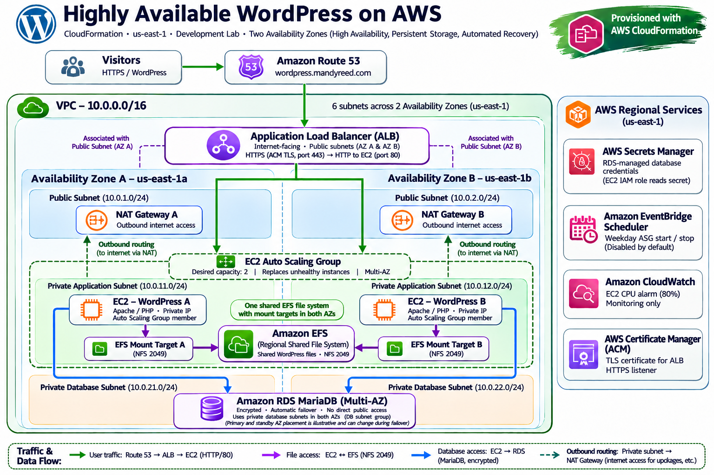

> **Project status:** Lab completed, tested, and torn down to avoid ongoing AWS charges. The WordPress URL and infrastructure are **not currently live**. The screenshots document the deployed environment and its tests.

## 🚀 The story

This started as a Simplilearn AWS Cloud Architect course-end project: deploy WordPress using CloudFormation, include a development/testing environment with operating-hour controls, and add monitoring. I decided to take the assignment further and see what a more resilient deployment would actually require.

I wanted more than a template that returned `CREATE_COMPLETE`. I wanted to know what happened when an EC2 instance failed, whether WordPress files and posts survived replacement, how private networking affected bootstrapping, and whether I could clean up the environment without leaving expensive resources behind.

The result was a hands-on lesson in the difference between **provisioning infrastructure** and **operating a working application**. I built it, broke it, debugged it, and tested recovery. 😅

## 🎯 Goals and outcomes

| Goal | Implementation / observed result |

| --- | --- |

| Reproducible infrastructure | AWS CloudFormation template provisions the network, compute, storage, database, monitoring, and scheduling resources. |

| Availability across two AZs | EC2 Auto Scaling Group spans private application subnets in `us-east-1a` and `us-east-1b`. |

| Automatic instance recovery | Tested unhealthy-instance replacement; Auto Scaling activity and healthy ALB targets were captured. |

| Persistent WordPress files | One Amazon EFS file system, with a mount target in each application AZ. |

| Persistent WordPress database | Amazon RDS MariaDB, encrypted storage, Multi-AZ enabled, and private database subnets. |

| Secure browser access | Route 53 alias and an ACM-backed HTTPS listener on the Application Load Balancer. |

| Reduced public exposure | WordPress EC2 instances have private IP addresses and no public IPs; RDS is not publicly accessible. |

| Development scheduling | EventBridge Scheduler definitions scale ASG capacity up/down on weekdays; both schedules are disabled by default; ASG capacity changes were tested manually. |

| Monitoring | CloudWatch CPU alarm configured at 80%, for monitoring rather than automatic scaling. |

| Responsible teardown | Deleted the CloudFormation stack, checked key resources, and removed the temporary WordPress DNS alias. |

## 🏗️ Architecture

**Region:** `us-east-1`  

**VPC:** `10.0.0.0/16`  

**Availability Zones:** `us-east-1a` and `us-east-1b`

| Subnet | AZ A | AZ B |

| --- | --- | --- |

| Public | `10.0.1.0/24` | `10.0.2.0/24` |

| Private application | `10.0.11.0/24` | `10.0.12.0/24` |

| Private database | `10.0.21.0/24` | `10.0.22.0/24` |

### Request and data flow

1. A visitor resolves `wordpress.mandyreed.com` using Amazon Route 53.

2. The internet-facing Application Load Balancer accepts HTTPS on port **443**, using an AWS Certificate Manager certificate.

3. The ALB forwards HTTP traffic on port **80** to healthy WordPress EC2 targets in the private application subnets.

4. EC2 instances access shared WordPress files on **Amazon EFS** through the mount targets in their respective AZs (NFS port **2049**).

5. Both WordPress instances use the same **Amazon RDS MariaDB** database, configured for Multi-AZ failover and encrypted storage.

6. The EC2 IAM role retrieves the RDS-managed database secret from **AWS Secrets Manager**.

7. Two NAT gateways, one in each public subnet, provide outbound access for private application instances.

**Important distinction:** The EFS file system is shared and regional; its mount targets are AZ-local. The RDS Multi-AZ database has a managed standby, not two independently writable WordPress databases. The architecture diagram represents these logical relationships rather than guaranteeing a particular primary/standby placement.

### AWS services

| Service | Purpose |

| --- | --- |

| CloudFormation | Infrastructure as code |

| VPC, subnets, route tables, internet gateway | Network segmentation and routing |

| NAT Gateway × 2 | Outbound internet access from private application subnets |

| EC2 and Auto Scaling | WordPress web servers and replacement of unhealthy instances |

| Application Load Balancer | HTTPS entry point, routing, and target health checks |

| Amazon EFS | Shared WordPress application files and uploads |

| Amazon RDS for MariaDB | Managed, encrypted Multi-AZ database |

| Secrets Manager | Managed database credentials |

| IAM and Systems Manager | Instance permissions and operational access |

| Route 53 and ACM | DNS and HTTPS certificate |

| EventBridge Scheduler | Weekday development ASG capacity scheduling |

| CloudWatch | CPU monitoring alarm |

## 📁 Repository structure

```text
.
├── README.md
├── .gitignore
├── cloudformation/
│   ├── wordpress-original.yaml       # Initial Simplilearn-era starting point
│   └── wordpress.yaml                # Expanded HA deployment
├── scripts/
│   ├── wordpress-config.py           # WordPress configuration helper
│   └── wordpress-userdata.sh         # User-data helper/reference
├── assets/
│   └── architecture/
│       ├── wordpress-ha-architecture.png
│       └── wordpress-ha-architecture.svg
└── screenshots/
    ├── 01-deployment/
    ├── 02-network-and-security/
    ├── 03-high-availability/
    ├── 04-scheduling-and-persistence/
    └── 05-monitoring-and-cleanup/
```

The original template is retained to show how the course assignment evolved. The expanded template is the primary infrastructure artifact. Helper scripts are included for readability and reference; the CloudFormation template is the deployment source of truth.

> **Asset note:** The supplied SVG may contain an embedded raster image. It can be displayed as SVG but may not offer individually editable shapes. The PNG is the recommended GitHub preview.

## 🛠️ Infrastructure as code: what I learned

The template uses CloudFormation parameters, mappings, conditions, resource references, and attributes to connect infrastructure components without hardcoding generated resource IDs.

**Parameters:** `EnvironmentName` selects `Development` or `Production`; `CertificateArn` supplies an existing ACM certificate; VPC/subnet CIDR parameters define the network. `LatestAmiId` resolves an Amazon Linux 2023 AMI using an SSM public parameter.

**Mappings:** `!FindInMap [EnvironmentConfig, !Ref EnvironmentName, InstanceType]` chooses an EC2 instance type for the selected environment. The same mapping pattern controls the RDS instance class and ASG capacities.

**Resource references:** `!Ref PrivateAppSubnet1` and `!Ref PrivateAppSubnet2` pass the created subnet IDs into the Auto Scaling Group's `VPCZoneIdentifier`. `!Ref WordPressTargetGroup` supplies the target group ARN to the ASG. `!GetAtt WordPressLaunchTemplate.LatestVersionNumber` selects the launch template version. `!GetAtt SchedulerExecutionRole.Arn` passes the role ARN to EventBridge Scheduler.

**Conditions:** Development-only scheduling resources depend on the `IsDevelopment` condition. HTTPS resources depend on the certificate-related condition; the template warns against logging in to WordPress over an unsecured endpoint.

These references were an important part of understanding how CloudFormation links resources and manages dependencies.

## 📸 1. Deploying the application

The deployment progressed beyond stack creation to a functioning WordPress installation and administration interface.

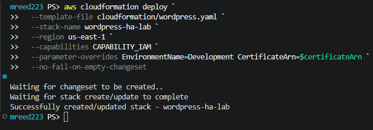

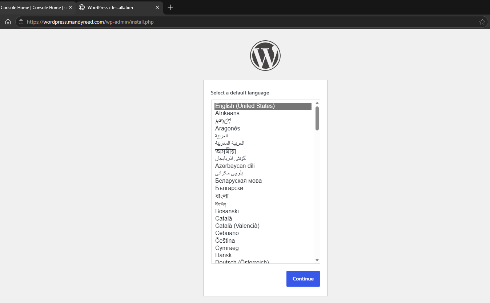

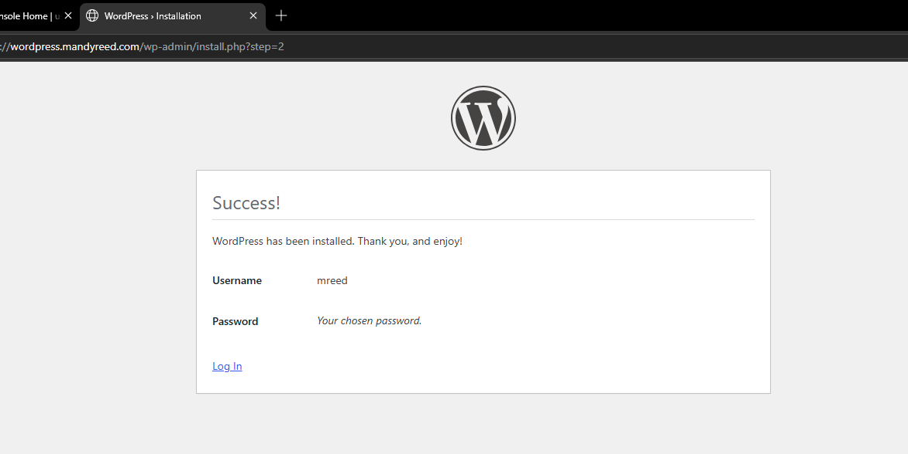

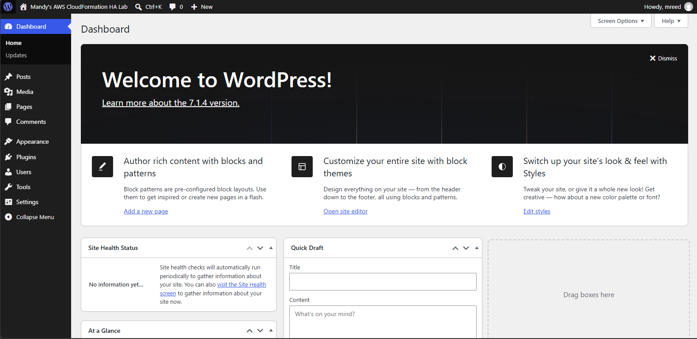

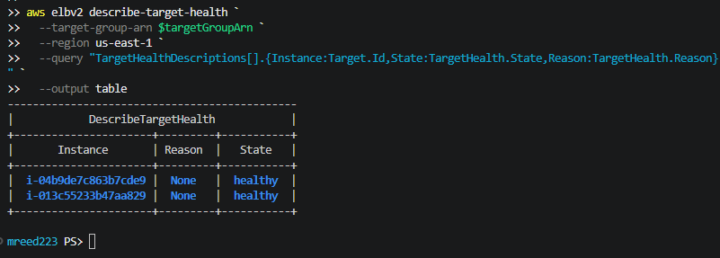

A green CloudFormation stack was only the beginning. The real work was ensuring both instances initialized WordPress correctly and became healthy ALB targets.

## 🔐 2. Networking, HTTPS, and shared storage

The ALB was publicly accessible; the application EC2 instances were not. They were deployed in separate private application subnets, with outbound internet access through AZ-local NAT gateways.

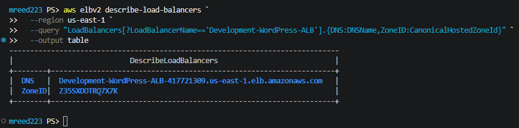

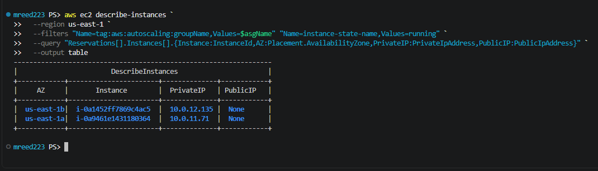

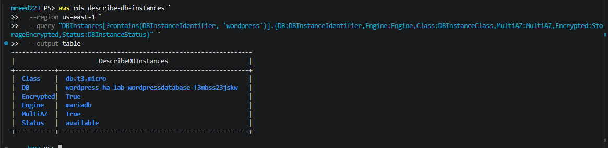

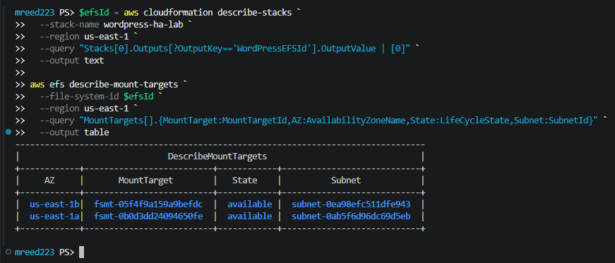

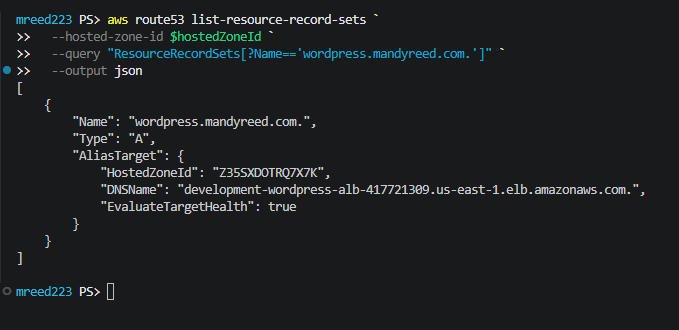

The DNS alias was temporary and was removed during cleanup. The public WordPress URL should not be expected to work now.

## 💥 3. Breaking EC2 and testing recovery

I wanted to verify that the architecture could tolerate an unhealthy or failed WordPress instance rather than just assuming the Auto Scaling Group would work.

The ASG was configured with a **desired capacity of two**, across two private application subnets, and used **ELB health checks**. During testing, Auto Scaling reported unhealthy-instance replacement activity. I then verified that the load balancer had two healthy targets again.

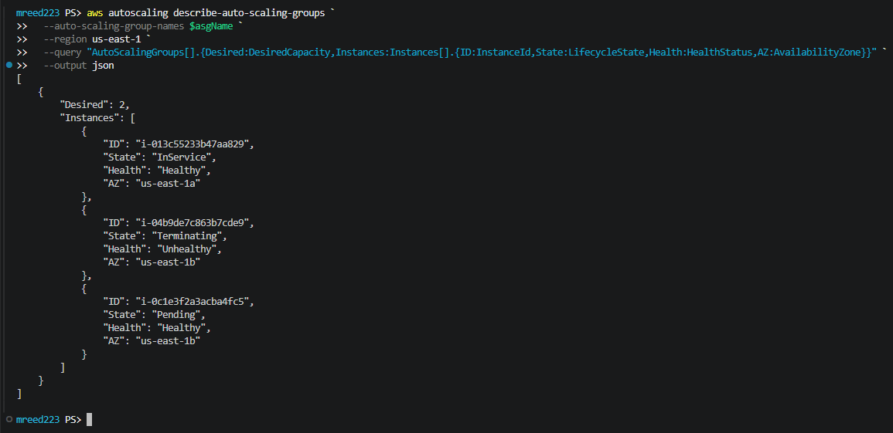

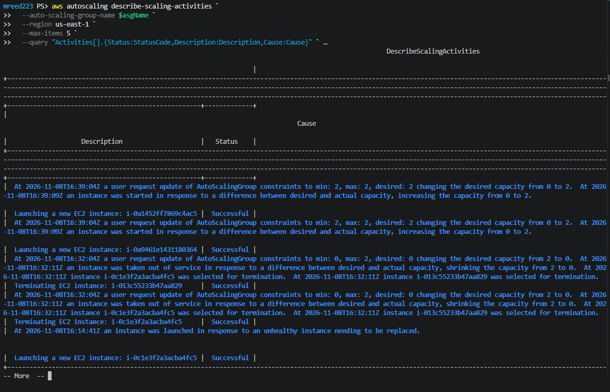

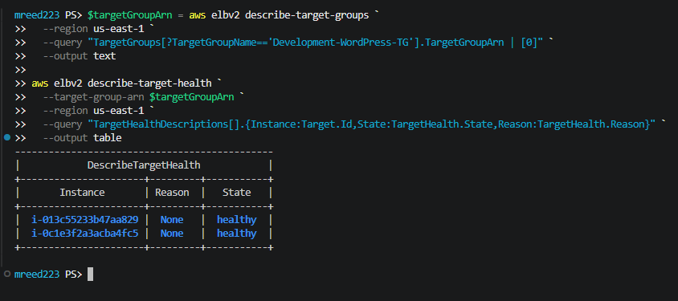

**What this demonstrates:** The combined evidence shows replacement activity and a return to two healthy load-balanced targets. A single screenshot alone does not prove the entire failure/recovery timeline.

## 🧩 4. Troubleshooting: where the learning happened

### Problem: Database connectivity with enforced TLS

RDS was configured to require encrypted database transport. The original MariaDB readiness/configuration flow did not correctly account for that requirement.

**Fix:** Update the readiness connection to use TLS and configure WordPress's MySQL client flags to request SSL (`MYSQLI_CLIENT_SSL`). This allowed WordPress to connect without turning off RDS's secure-transport requirement.

**Security caveat:** Requesting TLS is not the same as independently verifying the RDS server certificate. Certificate validation would be an additional hardening step.

### Problem: ALB health checks returned HTTP 403

The application instances had a local `/health.html` endpoint, deliberately separate from the shared EFS-mounted WordPress directory. Apache could not traverse the health directory because its permissions were too restrictive.

**Fix:** Add `chmod 755 /var/www/health` to EC2 UserData immediately after creating that directory, so **new instances** inherit the fix automatically. This was especially important for replacement instances created by Auto Scaling.

**Lesson:** A manually repaired server is not a reliable recovery strategy. The repair must live in the launch configuration so replacements initialize correctly.

### Problem: Deployment success ≠ application health

CloudFormation can successfully create infrastructure while user-data initialization, filesystem permissions, database connections, or target health checks still fail.

**Lesson:** Verify the application from the ALB all the way through EC2, EFS, and RDS. Health checks, boot logs, and CLI inspection were essential.

## ⏰ 5. Development scheduling and persistence

The development environment includes **EventBridge Scheduler** resources to adjust Auto Scaling capacity:

| Schedule | Intended behavior | Time zone |

| --- | --- | --- |

| Weekday start | Set ASG minimum and desired capacity to **2** at **9:00 AM**, Monday–Friday | `America/New_York` |

| Weekday stop | Set ASG minimum and desired capacity to **0** at **6:00 PM**, Monday–Friday | `America/New_York` |

**Important:** This scales the ASG to zero; it does **not** stop the RDS database, NAT gateways, or load balancer. Those resources can continue generating charges.

**Scheduling default:** Both EventBridge schedules are defined in `cloudformation/wordpress.yaml` with `State: DISABLED`. The schedules were kept disabled by default to prevent unexpected ASG capacity changes. The lab separately tested manual scale-down and restoration of the ASG; the screenshots do not establish that a scheduled invocation triggered those changes. Enable the schedules intentionally only when needed.

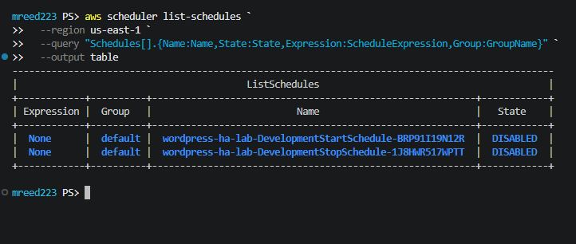

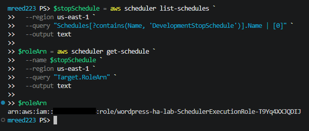

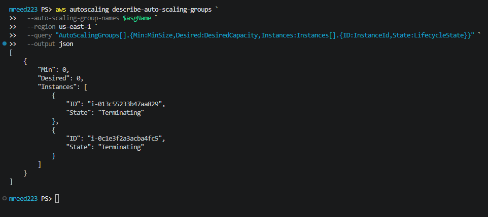

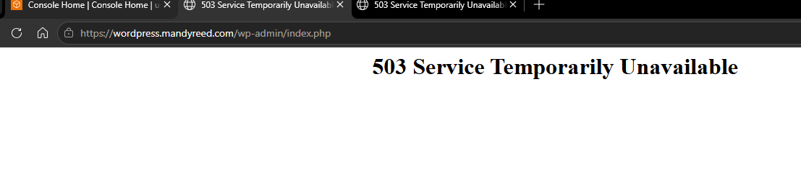

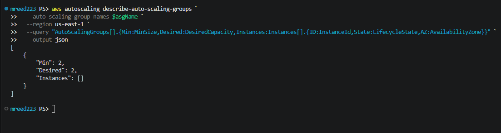

The restart screenshot shows the **desired capacity** restored, not necessarily two fully running and healthy instances at that exact moment. The ALB target-health screenshots document healthy targets separately.

### Verifying WordPress content after recovery

WordPress uses **RDS** for its database records and **EFS** for shared application files/uploads. The following captures show the WordPress test post and uploaded media accessible after recovery testing.

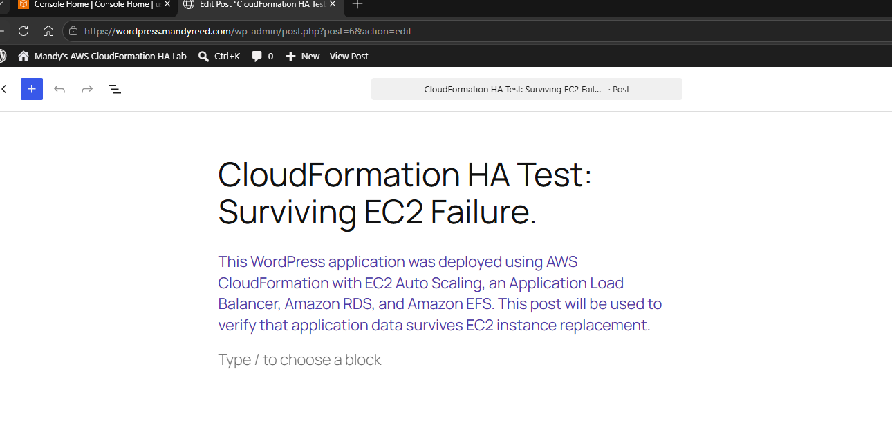

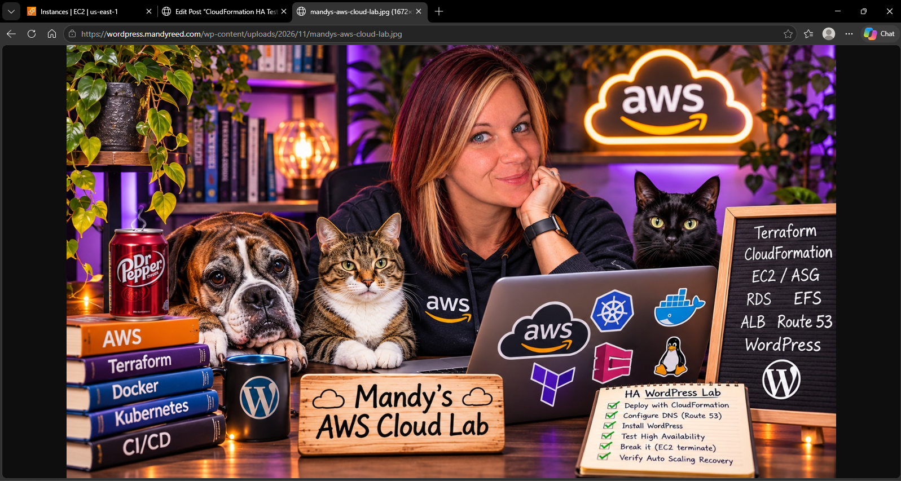

These screenshots are supporting evidence of accessible content, interpreted alongside the instance replacement and recovery activity. They do not, on their own, establish every step in the persistence test.

## 📈 6. Monitoring and cost awareness

CloudWatch was configured with a CPU utilization alarm at **80%**. It was used for monitoring, **not** as an Auto Scaling policy.

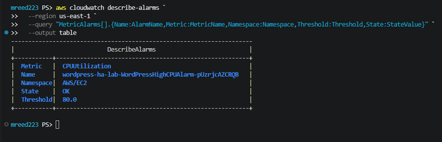

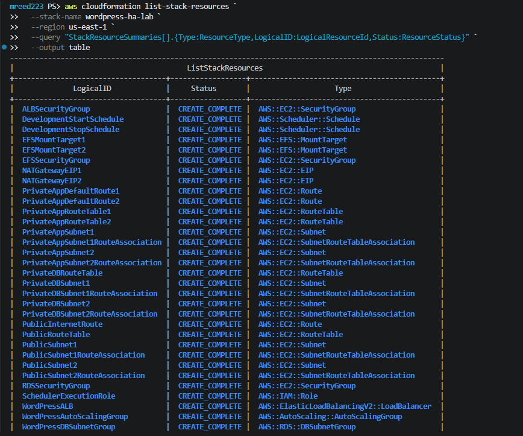

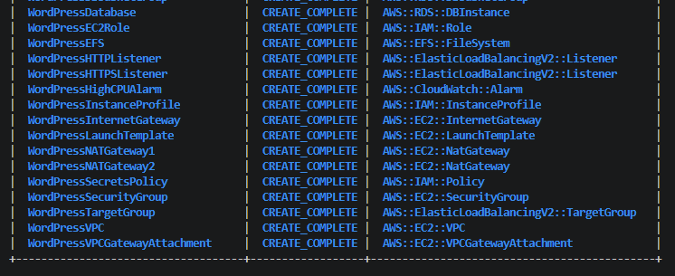

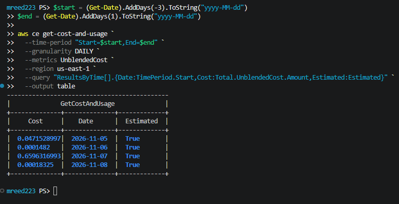

**Cost note:** The Cost Explorer screenshot contains **estimated, incomplete** charges at the time of capture. It is not a final invoice or proof of the total project cost. This architecture can be relatively expensive for a short-lived learning lab, especially with two NAT gateways, an ALB, and Multi-AZ RDS.

## 🧹 7. Teardown and cleanup

After the tests, I deleted the `wordpress-ha-lab` CloudFormation stack and waited for the deletion operation to complete. I checked for remaining NAT gateways, RDS DB instances, EFS file systems, and load balancers in `us-east-1`, and removed the temporary `wordpress.mandyreed.com` Route 53 alias.

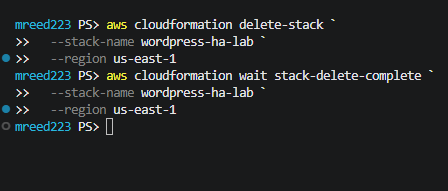

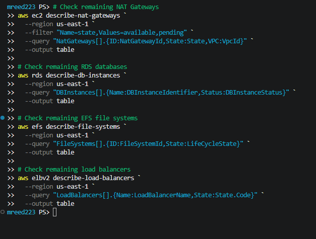

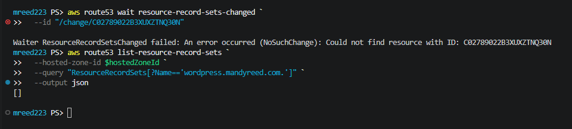

**Cleanup scope:** These checks support cleanup of the named stack and selected service types in the specified region. They are not a universal account-wide audit. The Route 53 screenshot includes a failed waiter lookup followed by a successful query returning no matching WordPress record.

## ▶️ Reproducing the lab

> ⚠️ **This deployment creates billable AWS resources.** Review the template, budget, scheduling defaults, and deletion behavior before running it. Do not deploy it unattended as a cost-saving measure. This is a development/learning architecture, not a production security or disaster-recovery reference implementation.

**Prerequisites:** AWS CLI configured with permissions to create the resources in the template, an ACM certificate in `us-east-1` for the chosen WordPress hostname, and a Route 53 hosted zone if using the example custom domain.

Validate the template:

```powershell
aws cloudformation validate-template `
  --template-body file://cloudformation/wordpress.yaml `
  --region us-east-1
```

Deploy after reviewing all parameters and the resulting resource costs:

```powershell
$certificateArn = '<your-issued-us-east-1-acm-certificate-arn>'
aws cloudformation deploy `
  --template-file cloudformation/wordpress.yaml `
  --stack-name wordpress-ha-lab `
  --region us-east-1 `
  --capabilities CAPABILITY_IAM `
  --parameter-overrides EnvironmentName=Development CertificateArn=$certificateArn
```

Review stack outputs:

```powershell
aws cloudformation describe-stacks `
  --stack-name wordpress-ha-lab `
  --region us-east-1 `
  --query 'Stacks[0].Outputs' `
  --output table
```

**DNS and installation:** Configure the WordPress hostname as a Route 53 alias to the new ALB, verify HTTPS and certificate hostname matching, and only then complete the WordPress administrator setup. A CloudFormation-created ALB does not automatically mean the external DNS record exists.

Delete the stack after testing:

```powershell
aws cloudformation delete-stack --stack-name wordpress-ha-lab --region us-east-1
aws cloudformation wait stack-delete-complete --stack-name wordpress-ha-lab --region us-east-1
```

Then separately verify retained or external resources, including the Route 53 alias, ACM certificate, and any independently created resources. **Never delete unrelated resources simply because they appear in the same AWS account.**

## 🧠 Lessons learned

- **High availability must be tested.** Two instances in different AZs look good on paper, but target health and replacement behavior tell the real story.

- **Persistent storage changes the failure model.** Application instances can be disposable when shared files and database records are maintained outside them.

- **UserData is part of the architecture.** A permissions fix that isn't automated can disappear with the next replacement instance.

- **Private networking has operational consequences.** NAT routing, security groups, EFS mount targets, and database access all matter during initialization.

- **Security settings affect application behavior.** Enforcing database TLS is useful, but the client configuration must support it.

- **Schedules and monitoring do different jobs.** Scheduler changes desired capacity; a CloudWatch alarm can simply observe a metric.

- **Cleanup is part of engineering.** Successful teardown and cost verification matter just as much as successful deployment.

## 🔮 Possible next improvements

- Validate the RDS server certificate, not only encrypted transport.

- Add automated application smoke tests and clearer post-replacement validation.

- Add notification actions to CloudWatch alarms.

- Automate DNS creation/removal as part of the deployment lifecycle.

- Evaluate lower-cost outbound networking patterns and resource lifecycle controls for development environments.

- Add a controlled database failover exercise with measured recovery time.

## 📚 Project context

This repository documents an extension of a **Simplilearn AWS Cloud Architect course-end project**. The original CloudFormation file is preserved to show the starting point, while the expanded implementation demonstrates additional work in networking, resilience, shared storage, managed databases, troubleshooting, observability, and cleanup.

**The biggest takeaway:** Getting CloudFormation to say `CREATE_COMPLETE` was the easy part. Getting the application to stay healthy, survive failure, and clean up afterward was where I learned the most. ☁️💚

---

**Built, broken, repaired, and documented as part of my hands-on AWS Cloud/DevOps learning journey.**
